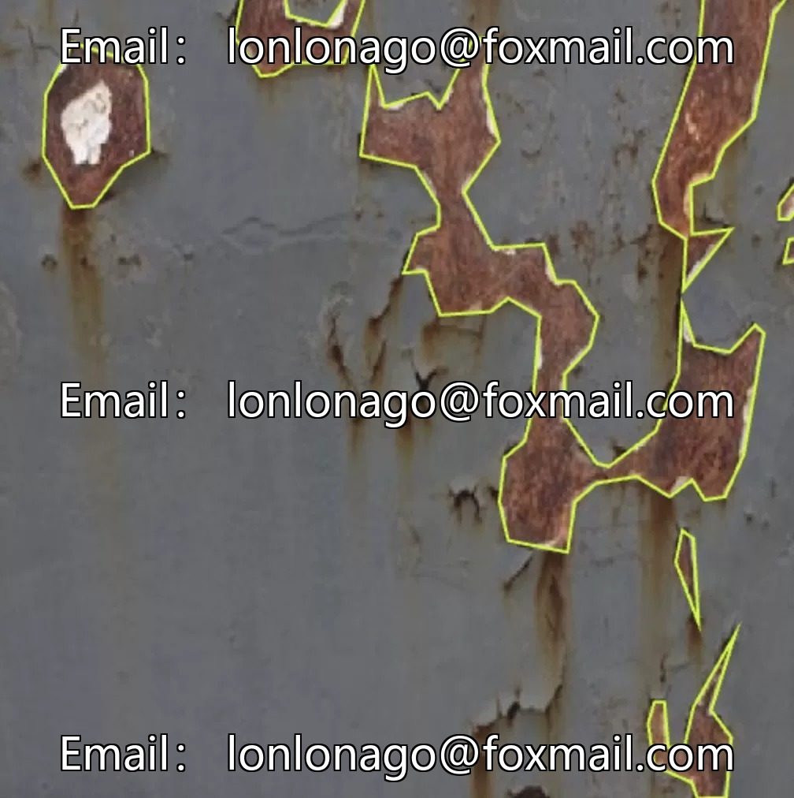
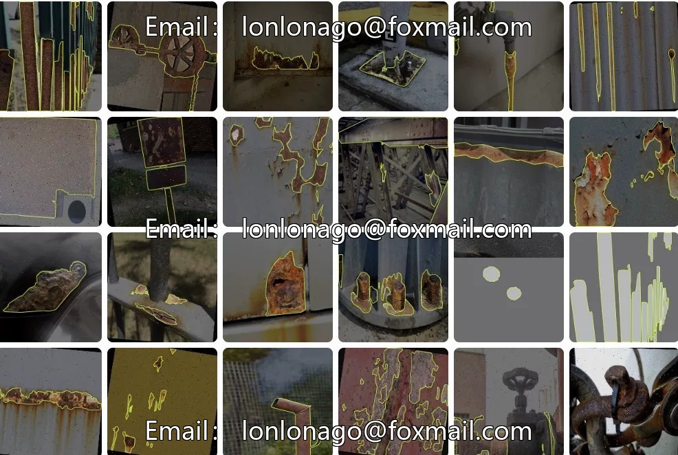
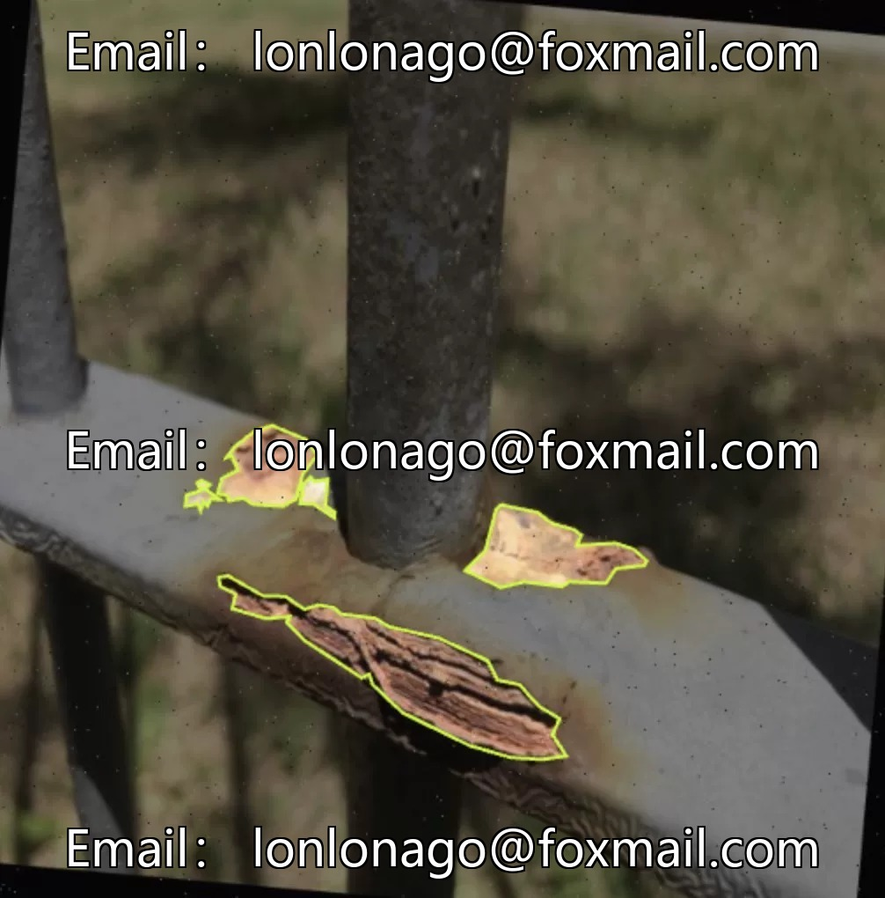
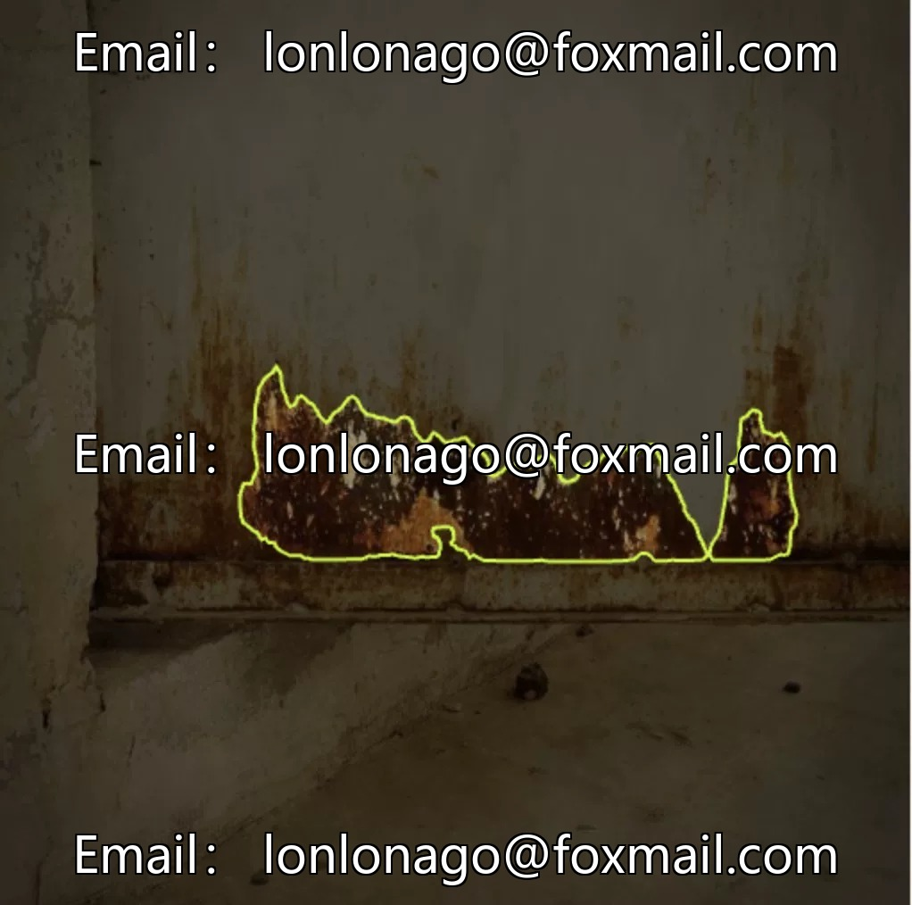
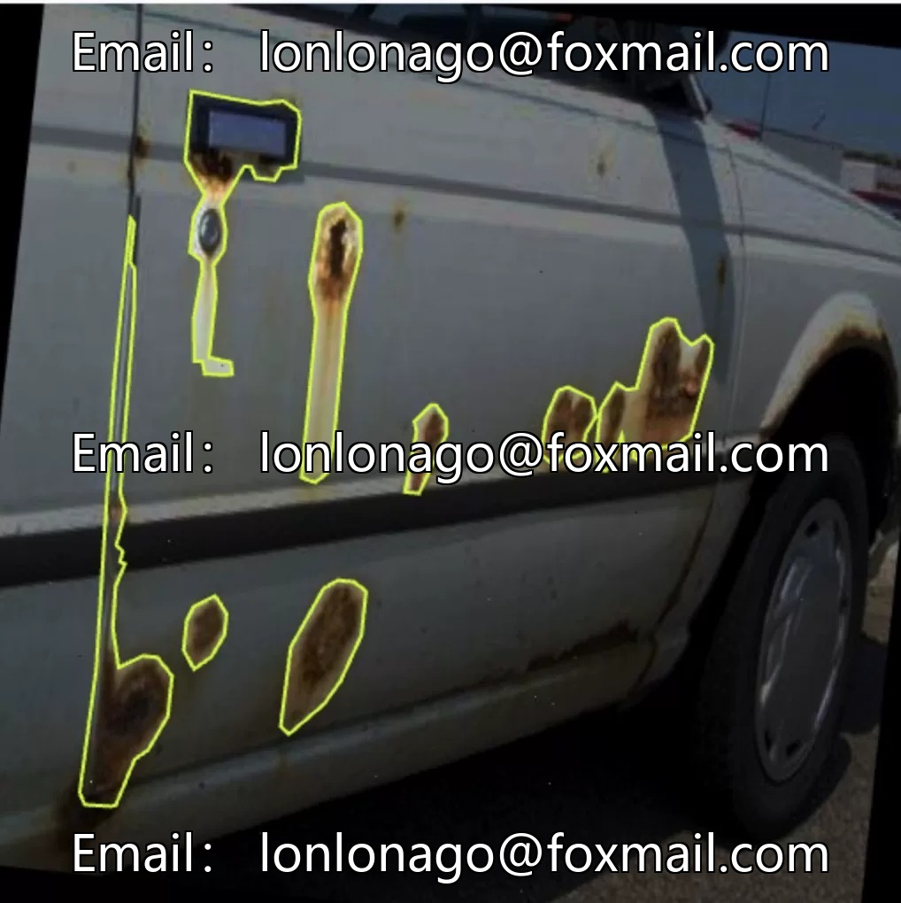

# Intelligent Industry - Rust Metal Detection Dataset, 6788 Images, Focus on Corrosion Scenarios

## Body

Intelligent Industrial Rust Metal Detection Dataset, 6788 images, focusing on corrosion scenarios (corrosion), suitable for industrial equipment, building structures, etc., corrosion detection, supports automated recognition of corrosion areas, improves detection efficiency.

The dataset is for computer vision instance segmentation, compatible with mainstream models (such as YOLO), and comes with a trained model ready to use, reducing development costs.

Virtual materials, once sold, are non-refundable.
Interested friends, click "I want" to proceed.

## Images

## Payment

Here is a pay link on Stripe ( https://buy.stripe.com/3cs8yP7sY87d0vu9AB ). Please contact me lonlonago@foxmail.com after funding $89, and I will send you a complete data files , thank you!

